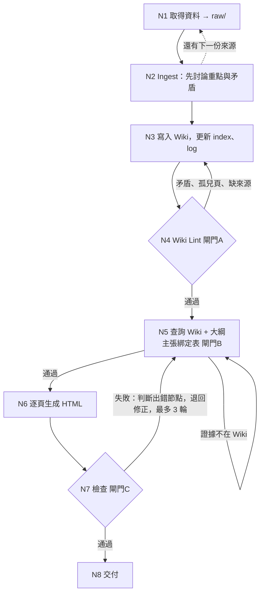

# 多旋翼無人機入門：LLM Wiki 與教學 HTML 簡報

> 第十週作業：用 LLM Wiki 做一份教學 HTML 簡報  
> 繳交標題：`朝陽 11530609 資通碩一 曾耀禾 多旋翼無人機入門`  
> 簡報連結：https://shmps40108-bryan.github.io/drone-llm-wiki/output/drone-slides.html  
> Wiki 連結（本 repo）：https://github.com/shmps40108-Bryan/drone-llm-wiki

## 一、LLM Wiki 主題與簡短介紹

**主題：多旋翼無人機入門——結構、飛行原理、應用與台灣法規。**

做法參考 Karpathy 的 LLM Wiki：不是每次提問才去翻原始文件（RAG），而是讓 LLM 先把資料整理成互相連結的 markdown 知識庫，之後都從知識庫回答。三層結構：

| 層 | 內容 | 位置 |
|---|---|---|
| 原始資料（唯讀） | 8 份來源：官方文件、Wikipedia、新聞、法條全文 | [`raw/`](raw/) |
| Wiki（LLM 維護） | 23 頁：8 篇來源摘要、12 篇概念、3 篇實體，另有目錄與紀錄 | [`wiki/`](wiki/) |
| 規則（schema） | 告訴 LLM 怎麼 ingest、lint、產簡報、檢查 | [`AGENTS.md`](AGENTS.md)（`CLAUDE.md` 只有一行 `@AGENTS.md`） |

資料的設計重點：來源有**可信度排序**（法條原文 > 官方技術文件 > 百科 > 新聞 > 舊文章），並刻意放入一份 2018 年的舊報導，讓 Wiki 必須處理「新舊資訊矛盾」。

## 二、LLM Wiki 連結與成果

- 入口：[`wiki/index.md`](wiki/index.md)（目錄）、[`wiki/log.md`](wiki/log.md)（完整時間序紀錄）
- 來源摘要頁：[`wiki/sources/`](wiki/sources/)，每頁連回對應的 `raw/` 原始檔
- 概念頁：[`wiki/concepts/`](wiki/concepts/)；實體頁：[`wiki/entities/`](wiki/entities/)
- 每個事實性主張都標來源，例如 `[S09 第6條]`；矛盾處有「## 爭議與過時」段落，說明採信哪個來源與原因
- 以 Obsidian 開啟專案資料夾，可用圖譜檢視看到 raw → 來源頁 → 概念頁 的連結

先 ingest 的是 S09（法條）與 S05（2018 舊報導），逐份與使用者討論重點後才寫入（「先討論、後生成」）。後面 5 份經使用者明確授權批次處理，已記錄在 log。

## 三、教學 HTML 簡報

- 檔案：[`output/drone-slides.html`](output/drone-slides.html)（單一檔案，不連外部資源，下載後直接雙擊可開）
- **線上瀏覽：https://shmps40108-bryan.github.io/drone-llm-wiki/output/drone-slides.html**
- 操作：按鈕、方向鍵 ← →、空白鍵翻頁；`G` 總覽；`F` 全螢幕
- 結構（16 頁）：封面 → 學習目標 → 什麼是無人機 → 結構 → 升力原理 → **互動示範**（按鈕看馬達加快或減慢）→ 為什麼要電腦 → 應用 → 風險 → 台灣法規（註冊、考照、飛行規則）→ 小心舊資訊 → 小結 → **小測驗**（6 題附答案）→ 來源與限制
- 每頁底部標示來源與對應的 Wiki 頁面

## 四、loop / graph 設計



**哪些步驟會重複？**
1. N1–N4 對每一份來源重複一次（一份份 ingest，每次 ingest 後都 lint）。
2. N4 發現問題就修 Wiki 再重跑，直到通過。
3. N5–N7：檢查失敗就退回，最多重試 3 輪。

**哪裡需要檢查或重新生成？**
- **閘門A（N4）**：矛盾、孤兒頁、缺來源標註、數字與法條原文是否一致。
- **閘門B（N5）**：簡報每個主張都要綁定到 Wiki 頁面，且「證據」必須是該頁面中逐字存在的片段，由腳本驗證。
- **閘門C（N7）**：來源標註、無 Wiki 外內容、數字、過時內容、教學結構、HTML 可用（互動測試與逐頁截圖）、繁體中文。

**為什麼這樣設計？**
- LLM 容易把自己知道的東西混進去，所以規定簡報**只能用 Wiki**，並讓每句話都能追溯到來源。
- 來源有新有舊，所以先在 Wiki 階段處理矛盾，簡報階段就不會把舊規定當現行。
- 失敗必須記錄在哪個節點、怎麼修，作為反思的真實素材。

## 五、一次實際執行的結果與檢查紀錄

完整紀錄：[`output/check-report.md`](output/check-report.md)、[`wiki/log.md`](wiki/log.md)

| 輪次 | 檢查方式 | 結果 |
|---|---|---|
| Wiki lint ×4 | 失效連結、孤兒頁、來源標註、數字對照法條 | 通過；處理了 4 組來源矛盾（見下） |
| 簡報第 1 輪 | 自動腳本 + 互動測試 + 逐頁截圖 + 人工讀 | **4 個失敗**（F1–F4） |
| 簡報第 2 輪 | 同上 | 全部通過 |
| 簡報第 3 輪（啟用閘門B） | 主張綁定表 119 列，證據逐字比對 | 回填時**再抓出 3 處**（F5–F7），修正後全部通過 |

**Wiki 階段處理的來源矛盾：**
1. 2018 年報導說「自然人操控 1–25 公斤就要考照」，現行法條是「2 公斤以上未達 15 公斤且有導航，或 15 公斤以上」→ 標為過時，採信法條。
2. 2018 年與 2024 年兩篇新聞對「25 公斤以下是否檢驗」說法不一 → 以法條為準並註記。
3. 新聞說「500 公克以上都須檢測」，法條全文找不到這個門檻 → 標「無法佐證」，簡報不採用。
4. 新聞說「2 公斤以下」商檢、法條是「未達 2 公斤」→ 剛好 2 公斤時結論相反，以法條為準，並放進簡報小測驗。

另外發現兩篇新聞（S06、S07）其實是**同一場記者會**，不能當作兩個獨立來源互相佐證。

## 六、反思

**哪個節點最常出錯？** N6 逐頁生成。第 1 輪的 4 個失敗全在這裡，其中最關鍵的是 F1：我在簡報第 4 頁寫了 Wiki 沒有的內容（「電動馬達便宜、輕、安靜」出自 raw 原文但 Wiki 沒收；「機架承載所有零件」則是我自己加的）。

**發現問題後，把檢查前移到哪裡？** 前移到 **N5 大綱階段**。原本只有 N7 事後檢查，而且自動腳本只能比對數字，F1 是人工逐頁讀才發現的。所以我（經使用者同意）啟用閘門B：每個主張先綁定 Wiki 頁面，並寫下 Wiki 裡逐字存在的證據，由腳本驗證。

**有修改 workflow 嗎？為什麼？** 有。修改了 `AGENTS.md` 的 N5 與流程圖，並記在 log。理由是：事後檢查太晚、也抓不到文字敘述；前移後腳本能逐列驗證。第 3 輪實際效果：回填綁定表時，又抓出第 2 輪人工檢查漏掉的 3 處 Wiki 外內容（F5–F7）。

**誠實的限制：**
- 閘門B 是在簡報已完成後才啟用，所以第 3 輪的綁定表是對現有簡報**回填**，不是生成前先寫。若重做一份新簡報，應該先寫綁定表再生成。
- 閘門B 能保證「簡報的主張在 Wiki 裡有逐字依據」，但不保證 Wiki 本身正確；Wiki 的正確性靠 N4 lint 與來源可信度排序。
- 全螢幕按鍵無法在自動測試環境驗證，手機也沒有實機測試。
- 禁航區、限航區的實際範圍與罰則金額不在來源內，簡報已明確標示為限制。

## 七、檔案一覽

```
raw/      原始資料（8 份，唯讀）
wiki/     LLM Wiki（index.md、log.md、sources/、concepts/、entities/）
output/   outline.md（主張綁定表）、drone-slides.html（簡報）、check-report.md（檢查紀錄）
AGENTS.md 規則（schema）
```

> 資料取得日：2026-11-10。法規相關內容以 [`raw/09-law-uav-management-rules.md`](raw/09-law-uav-management-rules.md)（113.11.14 修正版）為準；實際飛行前請自行查閱民航局最新公告與圖資。
